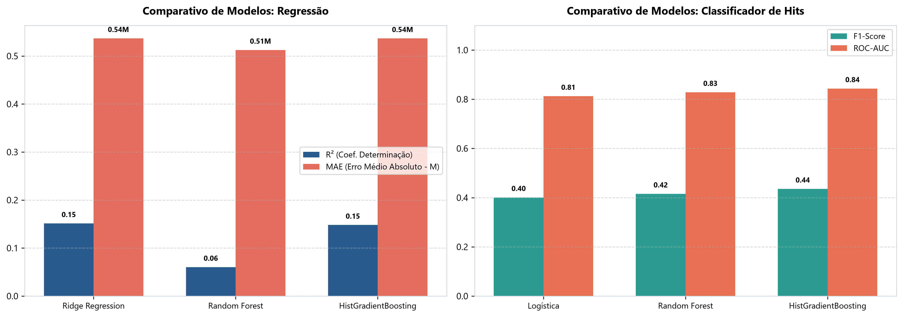

# 🎮 Análise de Vendas da Indústria de Games

[](https://www.python.org/)
[](https://pandas.pydata.org/)
[](https://scikit-learn.org/)
[](https://powerbi.microsoft.com/)
[]()

Projeto prático de **Engenharia de Dados (ETL), Business Intelligence (BI) e Machine Learning Preditivo** sobre o histórico global de comercialização de videogames nas últimas quatro décadas.

> **Status do Projeto:** Entrega 2/3 (ETL, Dashboard Power BI & Modelos de Machine Learning - AC2)

---

## 📌 Histórico de Entregas

### 🔹 Entrega 1 (AC1): Fundação de Dados & Dashboard Power BI
* **Pipeline de ETL em Python:** Tratamento de nulos, duplicidades, datas anômalas e exportação UTF-8 com BOM.
* **Feature Engineering:** Fabricante, Tipo de Plataforma, Década, Maior Mercado e Faixa de Vendas.
* **Dashboard Interativo (Power BI):** Relatório [`dashboard/AC1.pbix`](dashboard/AC1.pbix) com KPIs, evolução histórica, participação regional e catálogo de medidas em [`dashboard/MEDIDAS_DAX.md`](dashboard/MEDIDAS_DAX.md).
* **Análise Exploratória Automatizada:** Gráficos de alta resolução via `matplotlib` e `seaborn`.

### 🔹 Entrega 2 (AC2): Inteligência Artificial & Machine Learning Preditivo
* **Prevenção de Data Leakage:** Treinamento de modelos utilizando exclusivamente atributos conhecidos pré-lançamento (Gênero, Plataforma, Fabricante, Publisher e Ano).
* **Modelagem de Regressão (Estimativa de Vendas):** Comparação entre Ridge Regression, HistGradientBoosting e Random Forest para prever volume de vendas globais (`Global_Sales`).
* **Modelagem de Classificação ("Hit Predictor"):** Classificador binário para estimar se um título atingirá a marca de **1 Milhão de cópias vendidas** (Sucesso Comercial / Platinum).
* **Interpretabilidade (Feature Importance):** Análise dos fatores determinantes para o sucesso comercial de videogames.
* **Módulo de Inferência e Simulação:** Script executável [`scripts/simular_previsao.py`](scripts/simular_previsao.py) com cenários estratégicos prontos e modo interativo via terminal.
* **Relatório Técnico Completo:** Documentação metodológica em [`dashboard/RELATORIO_ML_AC2.md`](dashboard/RELATORIO_ML_AC2.md).

---

## 🤖 Desempenho dos Modelos de Machine Learning (AC2)

### 1. Modelos de Regressão (Volume de Vendas Globais em Milhões)
| Modelo | MAE (Erro Médio) | RMSE | R² (Coef. Determinação) | Veredito |
| :--- | :---: | :---: | :---: | :---: |
| **Ridge Regression (Baseline Regularizado)** | **0,537M** | **1,539M** | **0,151** | ⭐ **Melhor Estabilidade** |
| **HistGradientBoosting Regressor** | 0,537M | 1,542M | 0,148 | Alta Capacidade Não-Linear |
| **Random Forest Regressor** | 0,513M | 1,620M | 0,060 | Sensível à Cauda Longa |

### 2. Modelos de Classificação (Preditor de Sucesso Comercial - Hit $\ge$ 1M)
| Modelo | Acurácia | Precisão | Recall (Sensibilidade) | F1-Score | ROC-AUC |
| :--- | :---: | :---: | :---: | :---: | :---: |
| **HistGradientBoosting Classifier** | **75,7%** | **30,6%** | **74,3%** | **0,435** | **0,843** ⭐ |
| **Random Forest Classifier** | 73,4% | 28,6% | 75,0% | 0,415 | 0,828 |
| **Regressão Logística (Balanceada)** | 72,6% | 27,8% | 72,6% | 0,401 | 0,812 |

> **Destaque:** O classificador alcançou **ROC-AUC de 0,843** e captura **mais de 74% de todos os sucessos comerciais** do mercado histórico, tornando-se uma ferramenta de triagem de portfólio para publicadoras.

---

## 📊 Galeria de Visualizações Técnicas de ML (AC2)

| Comparativo de Modelos | Dispersão Real vs Predito |
| :---: | :---: |
|  |  |

| Matriz de Confusão do Hit Predictor | Curva ROC |
| :---: | :---: |
|  |  |

<p align="center">
  <b>Top Fatores mais Determinantes de Receita (Feature Importance)</b><br>
  
</p>

---

## 🖥️ Dashboard Interativo no Power BI (`AC1.pbix`)

O relatório foi construído no **Power BI Desktop** e está salvo em [`dashboard/AC1.pbix`](dashboard/AC1.pbix). A estrutura visual é composta por:

1. **Faixa Superior de KPIs (Container Executivo):**
   * `Total Vendas Globais`: Volume total faturado no histórico da base (~798 Milhões de cópias nos dados filtrados).
   * `Total de Jogos`: Quantidade de títulos catalogados e analisados (~16 Mil jogos).
   * `Ticket Médio por Jogo`: Média de vendas alcançada por título lançado (48,87 Mil cópias).
2. **Evolução Histórica das Vendas (1980 - 2016):**
   * Gráfico de Área demonstrando o crescimento gradual nos anos 80 e 90, e o grande ápice da indústria entre 2006 e 2010.
3. **Vendas Globais por Fabricante:**
   * Gráfico de Colunas detalhando o faturamento por ecossistema (Sony, Nintendo, Microsoft e PC).
4. **Vendas Globais por Gênero:**
   * Gráfico de Barras Horizontais evidenciando os gêneros de **Ação**, **Esportes** e **Tiro**.
5. **Participação por Região:**
   * Gráfico de Rosca apontando América do Norte (~49%) e Europa (~27%) como principais mercados.

---

## 📖 Dicionário de Dados (Base Tratada)

A base resultante do pipeline de ETL (`vgsales_tratado.csv`) conta com 21 colunas:

| Coluna | Tipo | Descrição |
| :--- | :--- | :--- |
| **Rank** | `int` | Posição no ranking global de vendas |
| **Name** | `str` | Título do jogo |
| **Platform** | `str` | Sigla da plataforma original (ex: PS2, X360, Wii) |
| **Year** | `int` | Ano de lançamento do jogo |
| **Genre** / **Genero** | `str` | Gênero traduzido em português (Ação, Esportes, Tiro, RPG...) |
| **Publisher** | `str` | Empresa publicadora |
| **NA_Sales** / **Vendas_Am_Norte** | `float` | Vendas na América do Norte (em milhões) |
| **EU_Sales** / **Vendas_Europa** | `float` | Vendas na Europa (em milhões) |
| **JP_Sales** / **Vendas_Japao** | `float` | Vendas no Japão (em milhões) |
| **Other_Sales** / **Vendas_Outros** | `float` | Vendas nas demais regiões do mundo (em milhões) |
| **Global_Sales** | `float` | Vendas globais totais (em milhões) |
| **Fabricante** | `str` | *Feature Criada:* Grupo/Marca da plataforma (Nintendo, Sony, Microsoft...) |
| **Tipo_Plataforma** | `str` | *Feature Criada:* Classificação (Console de Mesa, Portátil, Computador) |
| **Decada** | `str` | *Feature Criada:* Década de lançamento (Anos 80, 90, 2000, 2010+) |
| **Maior_Mercado** | `str` | *Feature Criada:* Região onde o jogo obteve maior receita |
| **Faixa_Vendas** | `str` | *Feature Criada:* Segmentação comercial (Super-Hit, Sucesso, Médio, Nicho) |

---

## 📁 Estrutura do Projeto

```text
ProjetoDeJogos/
├── Dados/
│   ├── Bruto/                  # Base original (vgsales.csv)
│   └── Tratado/                # Base limpa e enriquecida (vgsales_tratado.csv)
├── scripts/
│   ├── analise_inicial.py      # Exploração e estatísticas descritivas iniciais
│   ├── tratamento_dados.py     # Pipeline de limpeza e feature engineering (ETL)
│   ├── gerar_graficos.py       # Gráficos da análise exploratória da AC1
│   ├── treinar_modelos_ml.py   # Pipeline completo de ML (Treino, Teste & Métricas - AC2)
│   └── simular_previsao.py     # Simulador de inferência e predição de novos jogos (AC2)
├── modelos/                    # Modelos de Machine Learning serializados
│   ├── modelo_regressao.joblib
│   ├── modelo_classificacao.joblib
│   └── metadados_ml.json
├── dashboard/
│   ├── AC1.pbix                # Dashboard oficial no Power BI Desktop
│   ├── MEDIDAS_DAX.md          # Fórmulas DAX e documentação da tela do Power BI
│   ├── RELATORIO_ML_AC2.md     # Relatório técnico completo de Machine Learning (AC2)
│   ├── graficos/               # Visualizações da análise descritiva (AC1)
│   └── graficos_ml/            # Visualizações e métricas de Machine Learning (AC2)
├── requirements.txt            # Dependências Python (pandas, scikit-learn, joblib, etc.)
├── .gitignore                  # Regras de exclusão (.venv, caches, etc.)
└── README.md                   # Documentação oficial do projeto
```

---

## 🚀 Como Executar (Ambiente Local)

### 1. Preparar Ambiente Virtual
```powershell
# Ativar ambiente virtual existente
.\.venv\Scripts\Activate.ps1

# Ou instalar dependências completas
pip install -r requirements.txt
```

### 2. Executar o Pipeline de ETL (Tratamento de Dados)
```powershell
python scripts/tratamento_dados.py
```

### 3. Gerar os Gráficos Descritivos da AC1
```powershell
python scripts/gerar_graficos.py
```

### 4. Executar o Pipeline de Machine Learning (AC2)
Treina os modelos de regressão e classificação, gera os gráficos e serializa os artefatos:
```powershell
python scripts/treinar_modelos_ml.py
```

### 5. Simular Previsões de Novos Jogos
Demonstração com cenários automáticos:
```powershell
python scripts/simular_previsao.py
```

Ou modo interativo pelo terminal (insira qualquer jogo de teste):
```powershell
python scripts/simular_previsao.py --interativo
```

### 6. Abrir o Dashboard no Power BI
Abra o arquivo [`dashboard/AC1.pbix`](dashboard/AC1.pbix) no **Power BI Desktop** para interagir com o relatório.
