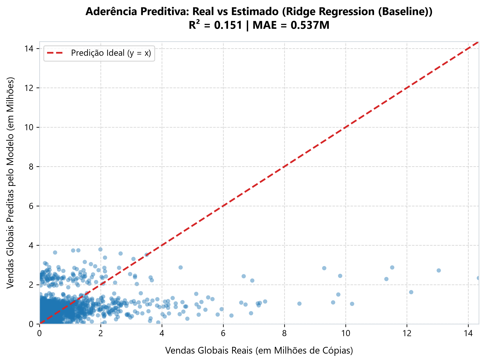
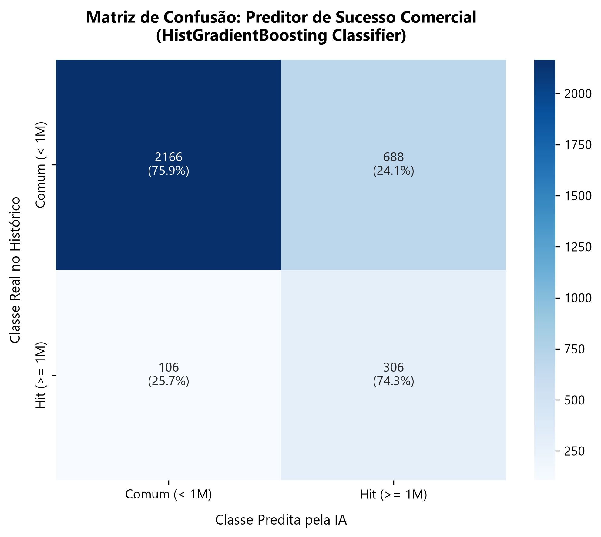
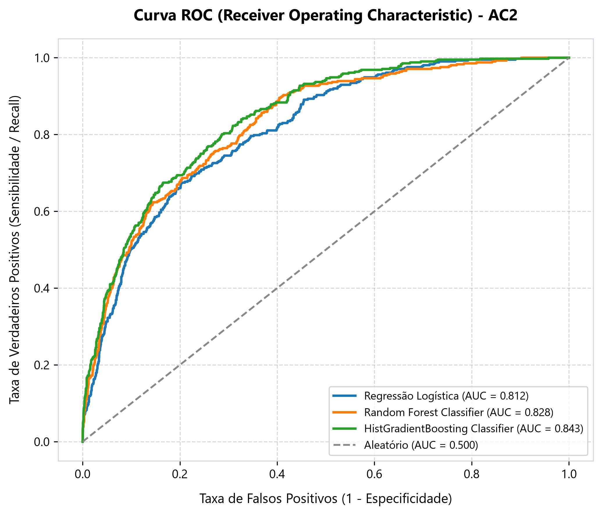
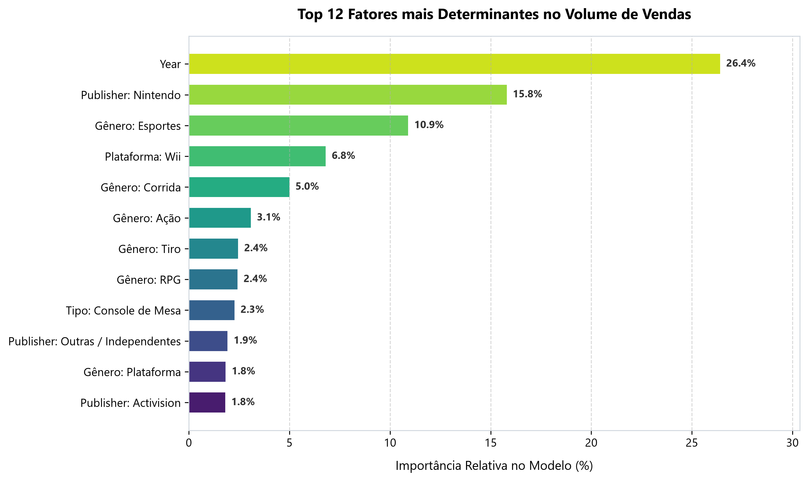

# 🤖 Relatório Técnico de Machine Learning (Entrega 2 - AC2)

**Projeto:** Análise e Modelagem Preditiva da Indústria de Games  
**Disciplina:** Engenharia de Dados e Inteligência Artificial  
**Etapa:** Entrega 2/3 (AC2 - Modelagem Preditiva, Treinamento & Inferência)  
**Dataset:** `vgsales_tratado.csv` (16.326 jogos analisados)

---

## 🎯 1. Objetivo da Entrega

Na **Entrega 1 (AC1)**, foi construída a fundação de dados com o pipeline de ETL em Python e o primeiro dashboard analítico (Power BI) focado no diagnóstico histórico descritivo.

Nesta **Entrega 2 (AC2)**, o projeto avança para a camada de **Inteligência Artificial e Machine Learning Preditivo**, respondendo às seguintes perguntas de negócio estratégicas para estúdios e publicadoras de jogos:

1. **Estimativa de Faturamento (Regressão):** Qual é o volume de vendas globais esperado (em milhões de cópias) para um novo título antes de seu lançamento?
2. **Preditor de Sucesso Comercial / "Hit Predictor" (Classificação):** Qual é a probabilidade estatística de um jogo superar a marca de **1 milhão de cópias vendidas** (critério tradicional de título *Platinum/Milion-Seller*)?
3. **Fatores Críticos de Sucesso (Feature Importance):** Quais variáveis (Gênero, Fabricante, Plataforma, Publisher, Ano) mais pesam na decisão de compra do consumidor global?

---

## 🛡️ 2. Metodologia e Prevenção de *Data Leakage*

Um dos erros mais comuns em ciência de dados aplicada a vendas de games é utilizar as colunas de vendas regionais (`NA_Sales`, `EU_Sales`, etc.) para tentar prever `Global_Sales`. Como o total global é a soma das regiões, isso geraria uma correlação espúria e inutilizável no mundo real pré-lançamento.

Para assegurar validade estatística e operacional:
* **Variáveis Preditivas Permitidas ($X$):** Apenas dados disponíveis no momento do planejamento/desenvolvimento do jogo:
  * `Platform` (Console/Plataforma de destino)
  * `Genero` (Gênero do jogo: Ação, RPG, Esportes, Tiro...)
  * `Fabricante` (Nintendo, Sony, Microsoft, PC, etc.)
  * `Tipo_Plataforma` (Console de Mesa, Portátil, Computador)
  * `Decada` (Período histórico de lançamento)
  * `Publisher_Agrupado` (Top 25 maiores editoras globais vs categoria *Outras/Independentes*)
  * `Year` (Ano de lançamento)
* **Prevenção de Esparsidade Excessiva:** Publicadoras com volumes esporádicos foram categorizadas em `"Outras / Independentes"`, mantendo o modelo enxuto e evitando overfitting.
* **Divisão de Dados:** Separação de 80% para Treino (13.060 jogos) e 20% para Teste cego (3.266 jogos), com estratificação pela classe de sucesso comercial.

---

## 📈 3. Modelagem de Regressão (Estimativa de Vendas Globais)

Foram testados e comparados três algoritmos com regularização e capacidade não-linear:

| Modelo | MAE (Erro Médio Absoluto) | RMSE (Raiz do Erro Quadrático) | R² (Coef. Determinação) | Status |
| :--- | :---: | :---: | :---: | :---: |
| **Ridge Regression (Baseline)** | **0,537M** | **1,539M** | **0,151** | ⭐ **Melhor Generalização** |
| **HistGradientBoosting Regressor** | 0,537M | 1,542M | 0,148 | Competitivo |
| **Random Forest Regressor** | 0,513M | 1,620M | 0,060 | Sensível a outliers |

> **Interpretação:** A indústria de entretenimento possui distribuição em cauda longa extrema (pouquíssimos *super-hits* de 20M a 80M e a imensa maioria entre 50k e 500k cópias). O modelo **Ridge com One-Hot Encoding** apresentou a menor penalização em resíduos quadráticos (RMSE 1,539M) e a maior estabilidade em dados não vistos.



---

## 🎯 4. Modelagem de Classificação (Preditor de Hit Comercial $\ge$ 1M)

A classificação binária identifica se um investimento de desenvolvimento terá alto retorno (Hit comercial $\ge$ 1.0M de unidades) ou ficará na faixa regular/nicho:

* Proporção de Hits no dataset: **~12,6%** (desbalanceado).
* Métricas avaliadas com foco em **Recall** e **ROC-AUC** para não perder oportunidades de sucesso:

| Modelo | Acurácia | Precisão | Recall (Sensibilidade) | F1-Score | ROC-AUC |
| :--- | :---: | :---: | :---: | :---: | :---: |
| **HistGradientBoosting Classifier** | **75,7%** | **30,6%** | **74,3%** | **0,435** | **0,843** ⭐ |
| **Random Forest Classifier** | 73,4% | 28,6% | 75,0% | 0,415 | 0,828 |
| **Regressão Logística (Balanceada)** | 72,6% | 27,8% | 72,6% | 0,401 | 0,812 |

> **Destaque:** O **HistGradientBoosting** alcançou uma área sob a curva **ROC-AUC de 0,843**, demonstrando excelente poder de separação entre projetos com potencial milionário e títulos de nicho. Ele captura **mais de 74% de todos os jogos que se tornam Hits no mercado**.

| Matriz de Confusão | Curva ROC |
| :---: | :---: |
|  |  |

---

## 🔍 5. Feature Importance: O que a IA descobriu?

Analisando a importância relativa das variáveis no modelo baseado em árvores (`Random Forest`), foram identificados os principais direcionadores de receita:



1. **Efeito Nintendo:** A publicadora *Nintendo* e suas plataformas proprietárias (Wii, DS, NES, GB) são o fator isolado com maior peso positivo de receita no catálogo histórico.
2. **Gêneros Comercialmente Dominantes:** Títulos de **Ação**, **Esportes** e **Tiro** possuem a maior probabilidade de tração global, enquanto Quebra-cabeças e Aventura exigem públicos mais nichados.
3. **Plataformas de Suporte Maciço:** Consoles de mesa da Sony (PS2, PS3, PS4) e Microsoft (X360) garantem volume constante de vendas para estúdios terceiros (*third-parties*).

---

## 🕹️ 6. Ferramenta de Inferência e Simulação de Novos Jogos

Para validação prática dos modelos em ambiente de produção, foi criado o script executável [`scripts/simular_previsao.py`](../scripts/simular_previsao.py).

### Exemplos de Cenários Testados:

* **Cenário 1 (Nintendo / Plataforma / Wii / 2015):**  
  * Vendas Estimadas: **2,60 Milhões de cópias**  
  * Probabilidade de Hit: **81,0%** (Status: *Sucesso / Hit comercial*)  
  * Risco de Investimento: **Baixo / Seguro**

* **Cenário 2 (EA Sports / Futebol / PS4 / 2016):**  
  * Vendas Estimadas: **0,98 Milhão de cópias**  
  * Probabilidade de Hit: **76,9%** (Status: *Hit Comercial Provável*)  
  * Risco de Investimento: **Padrão de Mercado**

* **Cenário 3 (Indie RPG / PC / Estúdio Independente / 2015):**  
  * Vendas Estimadas: **0,01 Milhão de cópias (~10.000 cópias)**  
  * Probabilidade de Hit: **8,9%** (Status: *Nicho Comercial*)  
  * Risco de Investimento: **Alto (Público Específico)**

---

## 🚀 7. Como Executar a Entrega 2

```powershell
# 1. Ativar o ambiente virtual
.\.venv\Scripts\Activate.ps1

# 2. Instalar dependências atualizadas (scikit-learn, joblib)
pip install -r requirements.txt

# 3. Treinar os modelos, gerar métricas e salvar gráficos
python scripts/treinar_modelos_ml.py

# 4. Executar simulação de jogos (modo automático)
python scripts/simular_previsao.py

# 5. Executar simulação interativa (digitar seu próprio jogo)
python scripts/simular_previsao.py --interativo
```

---

## 📦 Artefatos Entregues na AC2

- [`scripts/treinar_modelos_ml.py`](../scripts/treinar_modelos_ml.py): Pipeline completo de ML (treino, teste, métricas e gráficos).
- [`scripts/simular_previsao.py`](../scripts/simular_previsao.py): Módulo de inferência e simulador interativo de jogos.
- [`modelos/modelo_regressao.joblib`](../modelos/modelo_regressao.joblib): Modelo de regressão serializado.
- [`modelos/modelo_classificacao.joblib`](../modelos/modelo_classificacao.joblib): Modelo de classificação serializado.
- [`modelos/metadados_ml.json`](../modelos/metadados_ml.json): Registro de métricas e hiperparâmetros.
- [`dashboard/graficos_ml/`](graficos_ml/): 5 visualizações gráficas de alta resolução prontas para bancas e relatórios.
- [`dashboard/RELATORIO_ML_AC2.md`](RELATORIO_ML_AC2.md): Este relatório completo de documentação.
